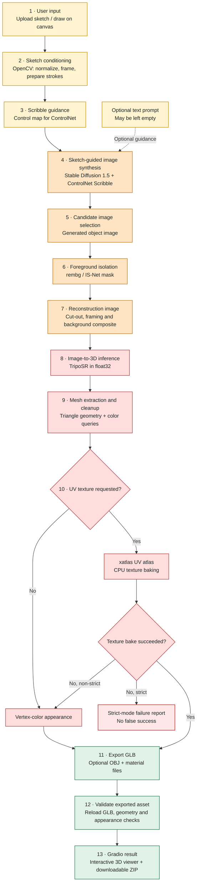

<div align="center">

# SketchForge3D

**Sketch-guided 3D asset generation with ControlNet and TripoSR**

*TechZephyr 4.0 · IIT Bhubaneswar · Sketch2Shape AI Challenge*

**Team BSP** — Saurabh Poddar & Biswasmita Rout

`Google Colab` · `Python 3.11` · `NVIDIA Tesla T4` · `GLB / OBJ`

</div>

## 1. Clear Overview

**SketchForge3D** converts a rough, single-view 2D sketch into an inspectable **3D triangle mesh**, reducing the effort needed to explore early-stage product concepts. Users can **upload a sketch or draw in the application** and optionally supply a text description. Text is **not required** to generate a model.

The system combines sketch conditioning, pretrained image generation, foreground isolation, and single-image 3D reconstruction. It exports an actual **GLB**, not merely a 2D render; optional OBJ export and UV texture baking are supported.

**Explore the evidence:** [**Watch the complete Gradio demonstration**][demo] · [**View the full report, screenshots and evaluated results**][report] · [**Open the Colab notebook**](SketchForge3D.ipynb)

## 2. Detailed System Architecture

The following vertical diagram follows the **implemented data flow**, including the optional-prompt path, strict UV behavior, and final export validation.



**Key design decisions:** ControlNet keeps visual generation tied to the sketch; **rembg/IS-Net** prepares the foreground for **TripoSR**; separate neural workers release GPU allocations between stages. The final GLB is reopened and checked after export. The project **integrates pretrained models**; Team BSP does not claim to have trained these networks.

## 3. Setup

**Required:** Google Colab with an available NVIDIA GPU, internet access, and enough disk space for model weights. Tested hardware: **Tesla T4**. Initial model downloads can take several minutes; the exact first-download time was not recorded.

1. Open [**SketchForge3D.ipynb**](SketchForge3D.ipynb) in [Google Colab](https://colab.research.google.com/).
2. Select **Runtime → Change runtime type → GPU**.
3. Run the notebook's setup cells **in order**. They create an isolated Python 3.11 environment and install the pinned dependencies.
4. Run the application's launch cell and open the interface link it provides.

**Dependency pins:** PyTorch `2.6.0`, Diffusers `0.30.3`, Transformers `4.44.2`, Hugging Face Hub `0.25.2`; see [`requirements.lock`](requirements.lock) and [`bootstrap.py`](bootstrap.py). Model weights download at runtime and are **not bundled** with the repository.

## 4. Execution — From Sketch to Download

1. **Input:** Upload a drawing or use the sketch canvas; the interface accepts an optional description.
2. **Configure:** Start with **Preview**, **seed 42**, and **one candidate**. UV baking can be enabled separately.
3. **Generate:** Click **Generate 3D Model**. The application displays preprocessing and pipeline progress.
4. **Inspect:** Review input/control images, foreground preparation, logs, and the generated **interactive 3D model**.
5. **Export:** Download the validated GLB or the result ZIP containing intermediate images, configuration, logs and reports.

**Input:** Single-object sketch image or canvas drawing; prompt may be empty.  
**Output:** `model.glb` and a run bundle; optional OBJ and baked-texture files.

<details>
<summary><strong>Optional command-line execution</strong></summary>

On Linux/NVIDIA hardware, after running `python bootstrap.py`:

```bash
.venv/bin/python engine.py run \
  --input sketch.png \
  --run-dir runs/example_new \
  --triposr-dir TripoSR \
  --quality preview \
  --seed 42 \
  --candidates 1
```

Add `--prompt "a wooden chair"` to guide appearance, or leave it out for the **no-prompt** path. Add `--texture --require-texture` to demand strict UV baking. Always choose a **new** run directory.

</details>

## 5. Model and Data Attribution

| Component | Purpose | Upstream source |
|:---|:---|:---|
| Stable Diffusion 1.5 | Generate the refined object image | [Model card](https://huggingface.co/stable-diffusion-v1-5/stable-diffusion-v1-5) |
| ControlNet Scribble | Preserve sketch-based structural guidance | [Model card](https://huggingface.co/lllyasviel/control_v11p_sd15_scribble) |
| rembg / IS-Net | Segment and isolate the object foreground | [Source](https://github.com/danielgatis/rembg) |
| TripoSR | Single-image 3D reconstruction | [Source](https://github.com/VAST-AI-Research/TripoSR) · [Weights](https://huggingface.co/stabilityai/TripoSR) |
| OpenCV, trimesh, PyMCubes, xatlas | Image preparation, mesh checks and UV/export processing | Respective open-source projects and pinned dependencies |

**Data used:** User-supplied and hand-drawn test sketches (including the documented mug example). **No custom training dataset, fine-tuning, or train/test split** is claimed. Pretrained-model and third-party licenses must be observed.

## 6. Sample Results and Evidence

For the **actual screenshots, Gradio demonstration, sketch-to-output comparisons, textured-model views, graphs, and evaluation tables**, use these submission links:

- **[Full project report and result screenshots][report]**
- **[End-to-end Gradio demonstration video][demo]**
- [Recorded evaluation CSV](evaluation.csv) · [Sample GLB files](runs/)

**Measured reference:** On a Tesla T4, evaluated Preview mug runs completed in approximately **50–52 seconds**, while the separate strict UV-baking run completed in **99.566 seconds**. One **no-prompt** batch run finished in **46.661 seconds**. These are observed runs, **not** promises for every sketch.

GPU telemetry recorded approximately **3.04 GiB** peak *PyTorch-allocated* memory during generation and **1.82 GiB** during reconstruction; these numbers are **not whole-device peak VRAM**. The report explains geometric quality and texture behavior in detail.

## 7. Limitations

- **Single-view ambiguity:** Hidden geometry must be inferred; an exported mesh may not be fully connected or manufacturing-ready.
- **Visual artifacts:** Background-removal or generation artifacts can affect final 3D shape; some mug tests showed detached handles or extra geometry.
- **UV appearance:** Strict baking produced an embedded texture, but one initial export rendered dark; a **separate** `engine_uv_fixed.py` experiment corrected its appearance without changing the original engine.
- **Resources and repeatability:** Colab GPU availability, cold downloads, and hardware/software differences affect runtime and exact output.

## 8. Troubleshooting

| Problem | Recommended action |
|:---|:---|
| No GPU / out of memory | Attach a GPU, select **Preview** and **one candidate**, and free other GPU workloads. |
| Package import failure | Restore the pinned environment; Hugging Face Hub `2.x` is incompatible with the pinned Transformers version. |
| Upload or drawing not accepted | Check the selected input mode, use a common image format, and relaunch the interface if widget state is lost. |
| Unexpected geometry | Inspect the sketch/control map, generated image and foreground mask before judging TripoSR. |
| Texture fails or looks dark | Inspect UV logs, try strict mode for verification, and compare with the separate material-correction backend. |
| Colab session interrupted | Download the ZIP promptly; files under `/content` may be lost when the session resets. |

---

**Team BSP — Saurabh Poddar & Biswasmita Rout**  
**Acknowledgements:** Hugging Face, Stability AI/TripoSR, ControlNet, rembg/IS-Net, PyTorch, OpenCV, trimesh, xatlas, PyMCubes, Gradio and Google Colab. Their pretrained models, code and licenses remain attributable to their original creators.

[report]: PASTE_REPORT_DRIVE_LINK_HERE
[demo]: PASTE_VIDEO_DRIVE_LINK_HERE

