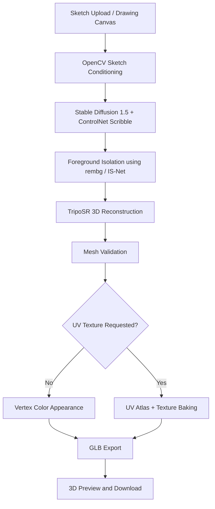

# SketchForge3D
### Sketch-Guided 3D Asset Generation Using ControlNet and TripoSR

**TechZephyr 4.0 | IIT Bhubaneswar | ML Hackathon**

**Team:** Team BSP  
**Team Members:**
- Saurabh Poddar
- Biswasmita Rout

**Domain:** Computer Vision, Generative AI and 3D Reconstruction  
**Platform:** Google Colab  
**Primary GPU:** NVIDIA Tesla T4  
**Output Format:** GLB (optional OBJ export)

---

## Project Demonstration and Documentation

| Resource | Link |
|---|---|
| GitHub Repository | [SketchForge3D](https://github.com/sourabhpoddar66-250/SketchForge3D) |
| Complete Project Report | [View Report and Screenshots](PASTE_REPORT_DRIVE_LINK_HERE) |
| Demonstration Video | [Watch SketchForge3D Demo](PASTE_DEMO_VIDEO_LINK_HERE) |
| Colab Notebook | [SketchForge3D.ipynb](SketchForge3D.ipynb) |
| Source Code | [engine.py](engine.py) |
| Evaluation Results | [evaluation.csv](evaluation.csv) |

> The report contains the detailed architecture, mathematical formulation, evaluation methodology, experimental results, screenshots, limitations and references.

---

## 1. Abstract

SketchForge3D is an end-to-end computer vision and generative AI system that transforms a single-view 2D sketch into a three-dimensional digital asset.

The system combines sketch preprocessing, Stable Diffusion 1.5, ControlNet Scribble, foreground isolation using rembg, and 3D reconstruction using pretrained TripoSR.

Users can provide a sketch through image upload or an in-application drawing interface. An optional text prompt can guide the appearance and characteristics of the generated object.

The pipeline reconstructs actual 3D geometry and exports the result as a GLB file. Optional UV texture baking provides texture-based surface appearance.

SketchForge3D is designed to make early-stage 3D asset creation more accessible to users without extensive 3D modeling experience.

The project includes reproducible configurations, pinned dependencies, mesh validation, measured runtimes, and documented reconstruction limitations.

---

## 2. Problem Statement

Traditional 3D modeling requires specialized software, technical expertise, and considerable time.

Transforming a rough hand-drawn sketch into a usable 3D model introduces several challenges:

- A 2D sketch does not explicitly represent depth.
- Hidden surfaces must be inferred.
- Rough sketches may contain incomplete contours.
- Generated images may not perfectly preserve the sketch.
- Reconstructed objects may contain geometric artifacts.
- The final output must contain genuine 3D geometry rather than a rendered 2D image.

The TechZephyr 4.0 Sketch2Shape AI challenge requires a functional system capable of converting a single-view sketch into an exportable 3D asset.

### Our Objective

Develop an accessible sketch-to-3D application that:

1. Accepts sketches through drawing or image upload.
2. Supports an optional text description.
3. Preserves important sketch characteristics.
4. Generates a suitable image for reconstruction.
5. Reconstructs meaningful 3D geometry.
6. Supports color and optional texture generation.
7. Validates and exports a usable 3D model.
8. Provides a practical and reproducible workflow.

---

## 3. Key Features

### Sketch Input

- Upload an existing sketch image.
- Draw an object using the notebook interface.
- Process black-on-white and white-on-black sketches.
- Normalize, resize and frame input images.
- Provide an optional text prompt.

### AI Image Generation

- Stable Diffusion 1.5 image generation.
- ControlNet Scribble conditioning.
- Configurable inference quality.
- Reproducible random seeds.
- Configurable candidate count.
- Sketch-guided generation with or without text.

### Foreground Preparation

- Background removal using rembg.
- IS-Net foreground segmentation.
- Foreground mask generation.
- Object framing and reconstruction-image preparation.
- Intermediate image preservation for debugging.

### 3D Reconstruction

- Real pretrained TripoSR reconstruction.
- Float32 inference.
- Triangle mesh generation.
- Vertex-color appearance.
- Optional UV texture baking.
- GLB export.
- Optional OBJ export.

### Validation

- Nonempty geometry checks.
- Finite vertex-coordinate checks.
- Positive mesh-area checks.
- Mesh extent validation.
- Connected-component reporting.
- Watertightness reporting.
- GLB export and reload validation.
- Texture embedding verification.

### Reproducibility

- Pinned model revisions.
- Locked dependency versions.
- Fixed random seeds.
- Per-stage execution logs.
- Hardware and GPU memory statistics.
- Recorded configuration files.
- Downloadable result bundles.

---

## 4. System Architecture

SketchForge3D follows a modular six-stage processing pipeline.



### Stage 1: Sketch Conditioning

The uploaded or drawn image is processed using OpenCV.

Operations include:

- Input normalization.
- Sketch framing.
- Stroke preparation.
- Resolution adjustment.
- Control-map generation.

The output is a structural guidance image used by ControlNet.

### Stage 2: Sketch-Guided Image Generation

Stable Diffusion 1.5 generates a refined image of the intended object.

ControlNet Scribble conditions the diffusion process on the sketch structure.

An optional text prompt provides additional information about object appearance.

The system supports generation without a user-provided prompt.

### Stage 3: Foreground Isolation

The generated image is processed using rembg and IS-Net.

The system estimates the foreground mask and prepares an isolated object image for reconstruction.

Intermediate images and masks are saved for inspection.

### Stage 4: Image-to-3D Reconstruction

TripoSR processes the prepared image and estimates three-dimensional geometry.

The system uses the pretrained TripoSR reconstruction backend.

Mesh extraction is supported by a CPU PyMCubes adapter.

### Stage 5: Mesh Processing and Appearance

The reconstructed mesh undergoes validation and appearance processing.

Supported appearance representations include:

- Vertex colors.
- Optional UV coordinates and texture atlas.
- Embedded texture-based GLB materials.

### Stage 6: Export and Validation

The processed asset is exported as a GLB file.

The exported model is reloaded and checked to confirm that it contains valid triangle geometry and the expected appearance representation.

The resulting model can be inspected in compatible 3D software.

---

## 5. Technologies Used

| Technology | Purpose |
|---|---|
| Python | Main programming language |
| PyTorch | Deep learning inference |
| Stable Diffusion 1.5 | Image generation |
| ControlNet Scribble | Sketch-conditioned generation |
| Hugging Face Diffusers | Diffusion pipeline integration |
| OpenCV | Image preprocessing |
| rembg / IS-Net | Foreground isolation |
| TripoSR | Single-image 3D reconstruction |
| DINO | Image encoding dependency used by TripoSR |
| PyMCubes | Mesh extraction |
| trimesh | Mesh processing and export |
| xatlas | UV atlas generation |
| Gradio | Interactive demonstration interface |
| Google Colab | GPU execution environment |

The project integrates pretrained models. No custom training or fine-tuning is claimed.

---

## 6. Installation and Quick Start

### Recommended Environment

- Google Colab
- GPU-enabled runtime
- Python 3.11
- NVIDIA GPU
- Internet connection for downloading pretrained models
- Sufficient disk space for model checkpoints

### Step 1: Open Google Colab

Visit:

https://colab.research.google.com/

Open or upload the project notebook:

`SketchForge3D.ipynb`

### Step 2: Enable GPU

Navigate to:

**Runtime → Change runtime type → GPU**

Select an available GPU runtime.

### Step 3: Execute the Notebook

Run the notebook setup cells in order.

The setup prepares an isolated Python environment and checks the required dependencies.

The environment is created separately from Colab's main Python kernel.

### Step 4: Open the Interface

Launch the interface provided by the notebook.

Choose one of the supported input methods:

- Upload an existing sketch.
- Draw a sketch using the available canvas.

### Step 5: Configure Generation

Recommended starting configuration:

| Parameter | Value |
|---|---|
| Quality | Preview |
| Seed | 42 |
| Candidates | 1 |
| Prompt | Optional |
| UV Texture | Disabled for initial test |
| Strict Texture | Disabled for initial test |

### Step 6: Generate the Model

Click the generation button.

The application executes the sketch-to-3D pipeline.

### Step 7: Inspect and Download

Inspect the generated model and download the output GLB or result bundle.

After verifying a successful basic run, optional UV texture baking can be tested.

**Note:** Notebook execution and GPU generation are separate operations. Running setup cells does not automatically mean that a new 3D generation job has been executed.

---

## 7. Command-Line Execution

SketchForge3D also provides a command-line inference engine.

On a compatible Linux/NVIDIA GPU environment, initialize the project using:

```bash
python bootstrap.py
```

After setup, execute:

```bash
.venv/bin/python engine.py run \
  --input sketch.png \
  --run-dir runs/example1 \
  --triposr-dir TripoSR \
  --prompt "a ceramic coffee mug" \
  --quality preview
```

### Optional UV Texture Generation

```bash
.venv/bin/python engine.py run \
  --input sketch.png \
  --run-dir runs/uv_example \
  --triposr-dir TripoSR \
  --prompt "a ceramic coffee mug" \
  --quality preview \
  --texture \
  --require-texture
```

The `--require-texture` option enables strict texture evaluation.

If texture baking fails in strict mode, the run reports failure rather than silently substituting vertex colors.

Use a new output directory for each run.

Other available parameters can be inspected using:

```bash
.venv/bin/python engine.py run --help
```

---

## 8. Model Architecture and Pretrained Models

SketchForge3D uses pretrained model components with fixed model revisions.

### Stable Diffusion 1.5

Model:

`stable-diffusion-v1-5/stable-diffusion-v1-5`

Purpose:

Generate a refined visual representation of the sketched object.

### ControlNet Scribble

Model:

`lllyasviel/control_v11p_sd15_scribble`

Purpose:

Guide image generation using structural information from the input sketch.

### TripoSR

Model:

`stabilityai/TripoSR`

Purpose:

Reconstruct a three-dimensional representation from a single prepared image.

The project uses TripoSR in float32.

TripoSR source commit:

`107cefdc244c39106fa830359024f6a2f1c78871`

### Foreground Segmentation

Library:

`rembg`

Segmentation model:

IS-Net

Purpose:

Separate the generated object from its background.

The complete model revisions and configuration are recorded in the project source and run metadata.

---

## 9. Dataset and Evaluation Inputs

SketchForge3D is an inference-based system built using pretrained models.

No custom training dataset or project-specific fine-tuning is claimed.

### Evaluation Inputs

The system has been evaluated using sketch inputs and different generation configurations.

Controlled experiments were performed on a mug sketch to investigate:

- Empty-prompt generation.
- Prompt-guided appearance.
- Mesh connectivity.
- Reconstruction consistency.
- Runtime.
- Foreground artifacts.
- UV texture generation.

Two additional sketch evaluations have also been reported by the team.

Their detailed measurements should be included in the evaluation record once the corresponding output bundles are verified.

### Dataset Limitation

The reported mug experiments represent controlled tests on one input sketch.

They do not constitute a large-scale quantitative benchmark across object categories.

---

## 10. Evaluation Methodology

The system is evaluated using functional, geometric, computational and visual criteria.

### Functional Evaluation

- Pipeline completion status.
- Successful GLB generation.
- Exported model readability.
- Valid geometry.
- Optional texture generation.

### Geometry Evaluation

- Vertex count.
- Triangle count.
- Connected components.
- Watertightness.
- Positive mesh area.
- Finite coordinates.
- Nonzero spatial extent.

### Computational Evaluation

- Total generation time.
- Stage-wise runtime.
- GPU memory allocation.
- Runtime environment.

### Visual Evaluation

- Object recognizability.
- Structural similarity to the sketch.
- Handle and part preservation.
- Surface coherence.
- Texture appearance.
- Unwanted reconstruction artifacts.

**Important:** Watertightness and triangle count are geometry diagnostics. They do not independently prove that an object is visually accurate or manufacturing-ready.

---

## 11. Experimental Results

### Evaluation Environment

| Component | Configuration |
|---|---|
| Platform | Google Colab |
| GPU | NVIDIA Tesla T4 |
| Python | 3.11 |
| PyTorch | 2.6.0 |
| Diffusers | 0.30.3 |
| Transformers | 4.44.2 |
| Hugging Face Hub | 0.25.2 |
| Reconstruction Backend | TripoSR |
| Input Resolution | 512 × 512 |
| Inference Steps | 20 |
| Seed | 42 |
| Candidates | 1 |
| Quality | Preview |

### Controlled Mug Experiments

| Experiment | Runtime | Triangle Count | Connected Components | GLB Validation |
|---|---:|---:|---:|---|
| Mug without prompt | 52.254 s | 36,348 | 2 | Passed |
| Mug with detailed prompt | 51.759 s | 21,552 | 1 | Passed |
| Mug with short prompt | 50.650 s | 41,584 | 2 | Passed |

The three tests used the same source sketch, seed and Preview settings.

### Observations

**Baseline Mug**

The generated model was recognizable and exported successfully.

However, the mug body and handle formed two disconnected mesh components.

**Detailed-Prompt Mug**

A prompt emphasizing physical attachment reduced the mesh component count from two to one.

The generated image showed horizontal surface artifacts.

**Short-Prompt Mug**

The generated image showed smoother surfaces but contained an unwanted oval-shaped artifact near the handle.

That artifact survived foreground isolation and reached the reconstruction input.

These tests demonstrate the relationship between image-generation quality and reconstructed geometry.

---

## 12. Stage-Wise Runtime Analysis

Measured runtimes are shown below.

| Processing Stage | No Prompt | Detailed Prompt | Short Prompt |
|---|---:|---:|---:|
| Conditioning | 0.094 s | 0.067 s | 0.070 s |
| Image Generation | 25.544 s | 25.001 s | 24.978 s |
| Foreground Preparation | 6.288 s | 5.867 s | 5.553 s |
| 3D Reconstruction and Export | 20.324 s | 20.821 s | 20.045 s |
| **Total** | **52.254 s** | **51.759 s** | **50.650 s** |

### Runtime Observations

Image generation and 3D reconstruction account for most of the processing time.

The system uses separate model execution stages to reduce simultaneous GPU memory requirements.

These measurements represent completed runs in the evaluated environment.

They are not guarantees of performance on other GPU configurations.

---

## 13. GPU Memory and Resource Usage

The evaluated system used an NVIDIA Tesla T4 GPU.

Previously reviewed runtime telemetry recorded approximately:

| Processing Stage | Peak PyTorch Allocated Memory |
|---|---:|
| Image Generation | 3.04 GiB |
| 3D Reconstruction | 1.82 GiB |

These values represent stage-specific PyTorch GPU memory allocation peaks.

They should not be interpreted as the overall maximum VRAM consumed by all processes and libraries.

### Model Downloads

Pretrained weights are downloaded during initial setup or first use.

The first execution may require additional time for model downloads and initialization.

Exact first-run download duration was not independently recorded.

Subsequent runs may reuse locally cached model weights.

---

## 14. UV Texture Baking Evaluation

SketchForge3D supports vertex-color appearance and optional UV texture baking.

### Strict UV Test

A dedicated strict UV-baking experiment completed successfully.

| Metric | Result |
|---|---|
| Texture Requested | Yes |
| Strict Mode | Enabled |
| Pipeline Status | Success |
| Embedded Texture | Verified |
| Texture Resolution | 512 × 512 |
| Total Runtime | 99.566 seconds |

The embedded texture was verified against the exported texture image.

### Material Appearance Correction

The original strict-UV GLB appeared unusually dark because of an exported material-factor issue.

A corrected GLB copy and a separate corrected backend were subsequently created.

The original engine and generated result were preserved.

The corrected material improved the visible appearance of the exported mesh.

This was an appearance correction, not a new reconstruction of the object's geometry.

### Source Files

- `engine.py`: original inference backend.
- `engine_uv_fixed.py`: separate backend copy with the tested UV material correction.

UV atlas seam duplication can affect connected-component counts reported on an indexed mesh.

Therefore, UV-split topology should be interpreted carefully when comparing reconstruction geometry.

---

## 15. Output Files

A completed run can produce:

```text
run_directory/
├── 00_input.png
├── 01_framed_sketch.png
├── 02_control.png
├── 03_candidate_1.png
├── 03_product.png
├── 04_foreground.png
├── 04_mask.png
├── 05_triposr_input.png
├── model.glb
├── config.json
├── generation.json
├── reconstruction.json
├── report.json
└── stage_logs/
```

The exact files depend on the run configuration.

Optional outputs include:

- UV texture image.
- OBJ and material files.
- Additional candidate images.
- Downloadable result ZIP.
- Notebook-generated viewer resources.

The exported GLB is the primary 3D deliverable.

---

## 16. Visual Results and Demonstration

The complete visual evidence is available in the project report and demonstration materials.

### Documentation

[View Complete Project Report and Screenshots](PASTE_REPORT_DRIVE_LINK_HERE)

The documentation includes:

- System architecture.
- Input sketch examples.
- Sketch conditioning images.
- Generated object images.
- Foreground masks.
- Reconstruction inputs.
- 3D model previews.
- UV texture comparisons.
- Runtime graphs.
- Geometry evaluation tables.
- Limitations and troubleshooting.

### Demonstration Video

[Watch SketchForge3D Demonstration](PASTE_DEMO_VIDEO_LINK_HERE)

The video should demonstrate:

1. Launching the application.
2. Uploading or drawing a sketch.
3. Entering an optional prompt.
4. Starting generation.
5. Displaying the generated object.
6. Viewing the reconstructed 3D model.
7. Rotating or inspecting the model.
8. Downloading the GLB output.

---

## 17. Reproducibility

The project uses an isolated Python 3.11 environment with pinned dependencies.

Important versions include:

| Package | Version |
|---|---|
| PyTorch | 2.6.0 |
| torchvision | 0.21.0 |
| Diffusers | 0.30.3 |
| Transformers | 4.44.2 |
| Accelerate | 0.34.2 |
| huggingface-hub | 0.25.2 |
| OpenCV | 4.10.0.84 |
| rembg | 2.0.60 |
| trimesh | 4.5.3 |
| xatlas | 0.0.11 |

The full dependency set is available in:

`requirements.lock`

Model identifiers and fixed revisions are defined in the source code.

The same random seed does not guarantee bit-identical results across different hardware and software environments.

### Reproducibility Checklist

- [x] Source code provided.
- [x] Dependency versions pinned.
- [x] Model revisions recorded.
- [x] Colab setup documented.
- [x] Genuine TripoSR reconstruction tested.
- [x] GLB export validated.
- [x] Empty-prompt generation tested.
- [x] Stage-wise runtime recorded.
- [x] UV baking tested.
- [x] CPU regression tests implemented.
- [ ] Independent fresh-environment reproduction confirmed.
- [ ] Final distinct-sketch evaluation evidence linked.

---

## 18. Troubleshooting

### No GPU Available

Select a GPU runtime in Google Colab.

Free GPU availability varies.

### GPU Out of Memory

Start with:

- Preview quality.
- One candidate.
- UV texture baking disabled.

Stop other GPU-intensive processes if necessary.

### Hugging Face Dependency Conflict

An environment update installed `huggingface-hub==2.4.0`, which was incompatible with the project's pinned `transformers==4.44.2`.

The original dependency environment was restored.

The compatible project versions include:

```text
transformers==4.44.2
diffusers==0.30.3
huggingface-hub==0.25.2
accelerate==0.34.2
```

Avoid independently upgrading locked ML dependencies without revalidating the pipeline.

### Background Removal Artifacts

Inspect:

- Generated image.
- Foreground mask.
- TripoSR input.

Artifacts originating during image generation may survive foreground isolation.

### Disconnected Geometry

A model can pass GLB validation and still contain disconnected parts.

Inspect the connected-component count and the visible mesh.

Detailed prompting may help but does not guarantee correct geometry.

### Texture Baking Failure

A non-strict run may retain vertex colors when texture baking fails.

Use strict texture mode when testing whether an embedded texture is genuinely produced.

### Dark UV Texture Appearance

Inspect the exported GLB material configuration.

The project includes a separately tested UV material correction in `engine_uv_fixed.py`.

### Colab Runtime Restart

Files under `/content` may disappear after a runtime reset.

Download result bundles or save important outputs to persistent storage.

### Viewer Not Loading

Download the GLB and inspect it using compatible software such as Blender.

---

## 19. Limitations

SketchForge3D is a prototype for early-stage 3D asset generation.

Known limitations include:

1. Single-view ambiguity when estimating hidden surfaces.
2. Disconnected mesh components in some reconstructions.
3. Image-generation artifacts affecting geometry.
4. Incomplete preservation of fine structural details.
5. Variable output quality across sketches and prompts.
6. Additional resource requirements for texture baking.
7. Dependence on pretrained model downloads.
8. GPU runtime availability and environment compatibility.

The generated assets are not claimed to be engineering-grade CAD models, manufacturing-ready 3D-printing meshes, or production-ready animation topology.

---

## 20. Real-World Applications

Potential applications include:

### Product Design

Rapid visualization of early product concepts from rough sketches.

### Architecture and Interior Design

Approximate 3D visualization of furniture and spatial ideas.

### Gaming and Animation

Generating draft assets that can be refined using conventional 3D tools.

### Education

Demonstrating computer vision, diffusion models and single-image 3D reconstruction.

### Creative Exploration

Helping users explore object ideas without requiring advanced modeling experience.

---

## 21. Future Improvements

Future development may focus on:

- Improved sketch understanding.
- Better foreground-artifact detection.
- More reliable connected geometry.
- Higher visual fidelity.
- Improved texture quality.
- Reduced inference time.
- Broader evaluation across object categories.
- Improved user experience and model preview.
- Greater robustness to incomplete sketches.

These items represent proposed work, not completed functionality.

---

## 22. Acknowledgements

Team BSP acknowledges the researchers, developers and open-source communities whose contributions made this project possible.

The system integrates pretrained models and third-party software.

### Pretrained Models

- [Stable Diffusion 1.5](https://huggingface.co/stable-diffusion-v1-5/stable-diffusion-v1-5)
- [ControlNet Scribble](https://huggingface.co/lllyasviel/control_v11p_sd15_scribble)
- [TripoSR](https://github.com/VAST-AI-Research/TripoSR)
- [TripoSR Weights](https://huggingface.co/stabilityai/TripoSR)
- [DINO](https://huggingface.co/facebook/dino-vitb16)

### Libraries and Tools

- [Hugging Face Diffusers](https://github.com/huggingface/diffusers)
- [Hugging Face Transformers](https://github.com/huggingface/transformers)
- [PyTorch](https://pytorch.org/)
- [OpenCV](https://opencv.org/)
- [rembg](https://github.com/danielgatis/rembg)
- [trimesh](https://github.com/mikedh/trimesh)
- [PyMCubes](https://github.com/pmneila/PyMCubes)
- [xatlas-python](https://github.com/mworchel/xatlas-python)
- [Gradio](https://www.gradio.app/)
- [Google Colab](https://colab.research.google.com/)

We acknowledge the respective authors and maintainers for their research, software and model releases.

The pretrained models and external libraries retain their respective licenses and usage conditions.

The original integration, pipeline orchestration, preprocessing logic, validation workflow and evaluation work are presented as Team BSP's project contributions.

---

## 23. Team

### Team BSP

**Saurabh Poddar**  
**Biswasmita Rout**

**Hackathon:** TechZephyr 4.0  
**Institution:** IIT Bhubaneswar — Event Host

### Project Repository

https://github.com/sourabhpoddar66-250/SketchForge3D

---

## Conclusion

SketchForge3D demonstrates a functional approach to transforming rough 2D sketches into exportable 3D assets using computer vision, generative AI and pretrained reconstruction models.

The project integrates Stable Diffusion, ControlNet, rembg and TripoSR into a reproducible pipeline with mesh validation, GLB export, optional UV texture generation and recorded performance measurements.

The evaluation confirms successful 3D generation while identifying important limitations in geometric fidelity and foreground isolation.

SketchForge3D is intended as an accessible tool for early-stage concept visualization and an extensible foundation for further sketch-to-3D research and development.
